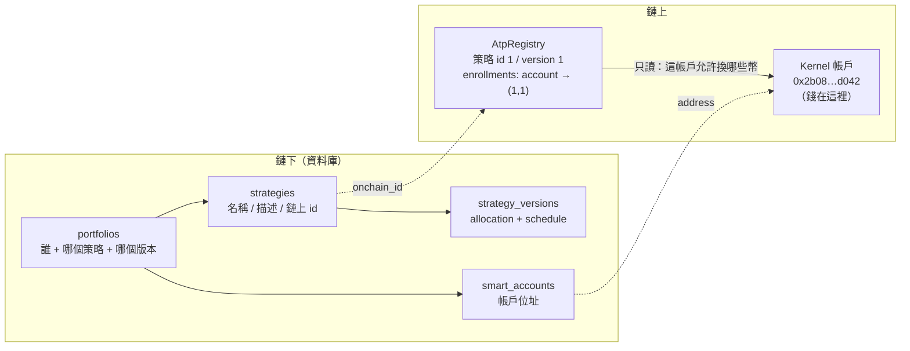
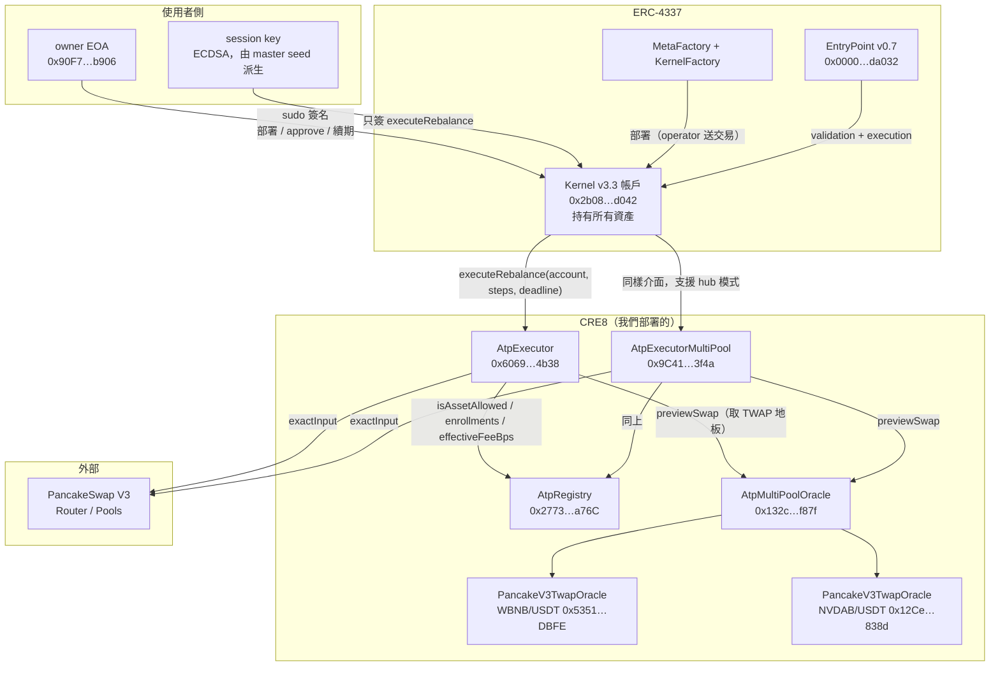
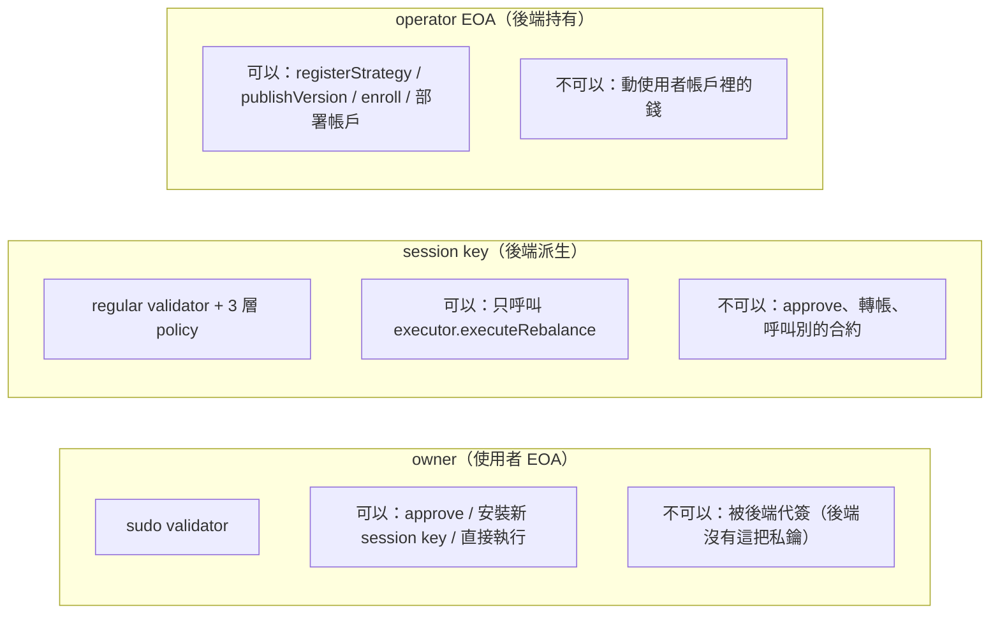
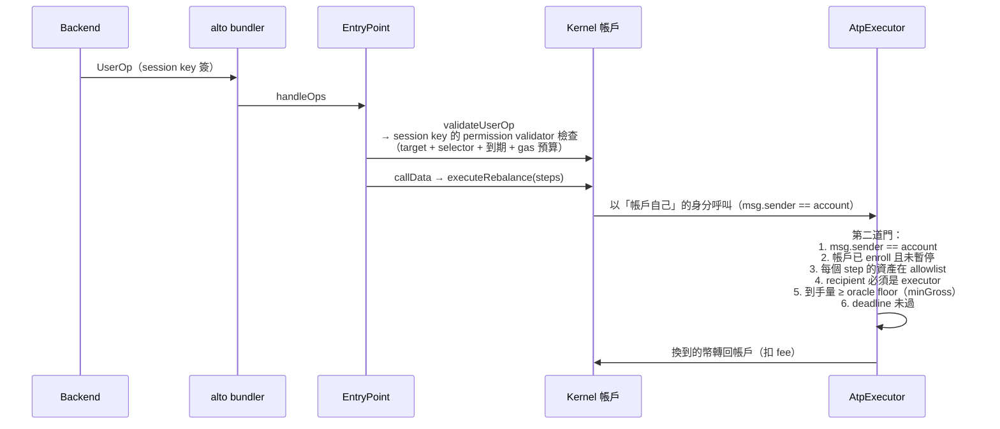
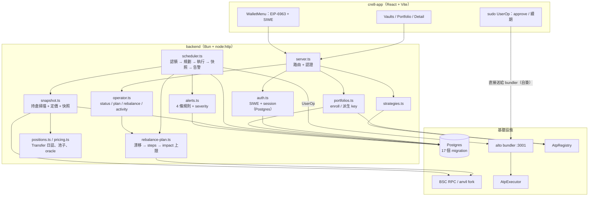
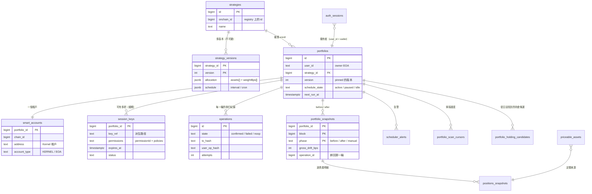
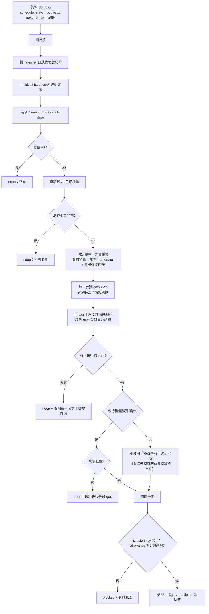

# 架構：合約、帳戶模型、後端

> 這是「錢在哪裡、誰能動它、誰負責什麼」的文件。
> 對照程式碼：`cre8-contracts/src/atp/*.sol`、`backend/src/*.ts`。
>
> 位址以 **BSC 56** 為準（fork 與主網同一組，見 `backend/src/addresses.ts`）。

---

## 公開參考資料與 CRE8 帳戶的邊界（2026-11-11）

`src/reference/` 保留釘定來源的 30 檔基金、219 個底層資產頁與 218 個 Create 選項；
`src/features/reference/` 呈現原始 NAV、人物、披露／貼文來源與期間統計。
這些模型資料不會自動成為 Registry 策略，也不能當成使用者帳戶的持倉或實績。
`src/lib/reference-refresh.ts` 只經 `/reference-data/demo-funds` 接收固定上游的完整公開更新，
驗證後原子套用；失敗保留原截止日，不轉發錢包憑證。
`/create` 負責設計／匯出，`/create/activate` 才經原生 API 啟用目標權重配置：
精確代幣地址仍須通過後端清單，設計器其他規則不會轉成執行權限。
真實帳戶、存提款與 Operator 沿用下述 CRE8 模型，詳見 [公開 UI 整合](public-ui-integration.md)。

---

## 0. 先回答一個常見誤解：**我們沒有為每個策略部署合約**

portfolio 頁那張表：

```
Fork Mag7 Index | 0x2b08…d042 | $835.48 | 1 bps | Aligned
```

| 欄位 | 那是什麼 | 是合約嗎 |
|---|---|---|
| `Fork Mag7 Index` | `AtpRegistry` 裡的一筆**策略資料**（on-chain id = 1，version = 1） | ❌ 是 storage，不是合約 |
| `0x2b08…d042` | 這個使用者為了**這個策略**部署的 **Kernel v3.3 智慧帳戶**（ERC-4337） | ✅ 是合約，但那是「帳戶」，不是「策略」 |
| `$835.48` | 該帳戶**持倉的市值**（用 oracle 價格算） | — |
| `1 bps` | 目前權重與目標權重的總偏差 | — |

也就是說：



**一個使用者 + 一個策略 = 一個帳戶。** 同一個策略可以被很多使用者各自 enroll，每個人拿到
自己的帳戶（地址由 `keccak(owner, strategyId)` 決定，可預測、可重算）。

策略本身是**資料**（allocation 是 `assets[] + weightsBps[]`），執行規則由 `AtpExecutor`
在鏈上強制。所以「改策略」不是換合約，而是**發一個新版本**並重新 enroll —— 舊版本不可變。

---

## 1. 用了哪些標準

| 標準 | 用在哪 | 我們實際依賴它的什麼 |
|---|---|---|
| **ERC-4337** | EntryPoint v0.7 `0x0000…da032`、`UserOperation`、bundler（alto） | 讓「session key 簽名 → 送出」不需要使用者持有原生幣以外的東西；`initCode` 讓帳戶部署與權限安裝在同一筆 |
| **ERC-20** | 所有資產（USDT、NVDAB、WBNB… 皆 18 decimals） | `balanceOf` 定價、`approve` 給 executor、`safeTransferFrom` 拉幣 |
| **Kernel v3.3 modular account** | 每個投組的帳戶 | sudo(ECDSA) validator = owner，regular permission validator = session key |
| **EIP-4361 (SIWE)** | 鏈下登入 | 證明錢包擁有者；**與鏈上權限無關** |
| **EIP-712** | 權限安裝的 enable 簽章（ZeroDev permission validator） | 讓「安裝 session key」是一次可驗證的結構化簽名 |
| **ERC-1271** | Kernel 帳戶對合約簽章的驗證 | 由 SDK 提供；**未在本專案單獨驗證**（見 §8） |
| **Uniswap V3 (PancakeSwap fork)** | 兌換路徑 | `exactInput`、池子 `slot0/liquidity`、TWAP |
| **Permit2** | ❌ **沒有用** | `AtpExecutor` 仍走一般 `safeTransferFrom`（合約裡有 `TODO(permit2)`） |
| **ERC-721 / 1155** | ❌ 沒有用 | enroll 是 `mapping(address => Enrollment)`，**不是 NFT** —— 所以「份額」不是可轉讓的 token |

⚠ **最後一點對產品很重要**：portfolio 頁的「Your funds」不是可轉讓的基金份額，
而是「你擁有的帳戶」。沒有二級市場、沒有 transfer。

---

## 2. 合約架構



### 每個合約的責任

| 合約 | 做什麼 | 不做什麼 |
|---|---|---|
| **AtpRegistry** | 策略註冊（`registerStrategy`）、不可變版本（`publishVersion`）、enrollment（`enroll` → 帳戶綁 (id, version)）、費用（`effectiveFeeBps`）、暫停（`setPaused`） | 不持有資金、不執行交易 |
| **AtpExecutor** | 唯一動錢的地方：驗證每個 step（資產在 allowlist、recipient 是 executor、deadline、minGross）→ `safeTransferFrom` → swap → 轉給帳戶（扣 fee） | 不決定策略、不保管資金、不判斷「該不該再平衡」 |
| **AtpExecutorMultiPool** | 同上 + 「hub 模式」：所有腿都是 `資產 ↔ numeraire（USDT）`，支援 >2 資產 | 同上 |
| **AtpMultiPoolOracle** | `oracleOf(asset)` → 該資產的 per-pair oracle；未註冊就 revert `OracleNotSet` | 不自報價 |
| **PancakeV3TwapOracle** | 對單一池子算 TWAP，回 `previewSwap` 的 floor（最小到手量） | 不看別的池 |
| **Kernel 帳戶** | 持有資產、執行 `approve` / `executeRebalance`、驗證簽名 | 不含任何策略邏輯 |
| **EntryPoint** | 驗證 UserOp、付 gas、執行 callData | 與 CRE8 無關（標準元件） |

**設計上最重要的一條**：**Executor 是唯一能動錢的合約**，而它只做「照著 steps 換幣」。
策略、權重、排程、要不要動 —— 全部在鏈下（後端）決定。這是刻意的：
換策略不需要部署新合約，改參數不需要升級 proxy。

---

## 3. 帳戶與安全模型

### 三個身分



### session key 的三層限制

| Policy | 內容 | 為什麼 |
|---|---|---|
| **CallPolicy** | 只允許 `executor.executeRebalance`（selector `0x1b977850`） | 讓那把 key 只能做一件事 |
| **TimestampPolicy** | `validUntil`（DB 的 `enrollment_intents` 固定住，重試不會變） | 到期自動失效，續期是換一把新的 |
| **GasPolicy** | 一次 1e18 wei 的預算，用完不重置 | 限制一把 key 能被消耗的上限 |

⚠ **CallPolicy 只驗 target + selector，不驗參數**。所以 session key 一旦裝上，
executor 的 `executeRebalance` 任何參數都叫得動 —— 參數層的護欄（資產 allowlist、
recipient、minGross、deadline）全部在 **executor 合約裡**，不是在帳戶層。

### 誰能動錢：兩道門



**兩道門都在鏈上**：第一道在帳戶（誰能發起），第二道在 executor（發起之後能做什麼）。
後端只是「提出意圖」，它兩個門都繞不過。

### 責任邊界

| 角色 | 負責 | 不負責 |
|---|---|---|
| **使用者** | 保管 owner 私鑰；付 gas；approve 一次 | 不需要盯盤、不需要每輪簽名 |
| **後端（operator）** | 算漂移、規劃 steps、估價、前置檢查、送 UserOp、寫快照與告警 | **不能動錢**（沒有 owner key）、不能繞過 executor 的檢查 |
| **session key** | 只簽「呼叫 executeRebalance」 | 不能 approve、不能轉帳 |
| **Registry owner** | 上架策略、設 fee、暫停 | 不能動使用者資金（⚠ v1 是單一私鑰，上主網前要換 multisig/timelock） |
| **Bundler（alto）** | 代送 UserOp、付自己的 executor gas | 不簽名、不決定內容 |

---

## 4. 後端架構



### 請求路徑與排程路徑是同一套規劃器

| | 手動（UI） | 自動（排程器） |
|---|---|---|
| 入口 | `POST /portfolios/:id/rebalance` | `--loop --live`，每 60 秒認領到期的 portfolio |
| 規劃 | `rebalance-plan.ts` | **同一個** |
| 前置檢查 | 同一份（session key / allowance / 餘額） | **同一份** |
| 送出 | 同一支 UserOp 組裝 | **同一支** |
| 快照 | before / after | **同一份** |
| 差別 | 有人按按鈕 | 計時器 |

**為什麼要強調這件事**：如果手動與自動走不同程式碼，就會出現「在 UI 測得過、排程器卻失敗」
這種最難查的 bug。這裡刻意只有一條路。

### 資料庫（17 個 migration）



**幾個刻意的設計**：

- `strategy_versions` 是不可變的 → 改權重 = 新版本；`portfolios.version` 是「釘住的版本」，
  所以策略作者改權重不會偷改既有跟隨者的配置。
- `portfolio_snapshots` 的 PK 是 `(portfolio_id, block, phase)` → 同一塊重跑是 UPDATE 不是新增。
- `session_keys` 可以有多把 → 續期不是覆蓋，舊的到期前仍然有效。
- `auth_sessions` 存 `sha256(token)` → DB 洩漏不等於 session 洩漏。

---

## 5. 一輪再平衡的內部流程（規劃器）



---

## 6. 信任假設（上主網前要複查）

| 假設 | 現況 | 風險 |
|---|---|---|
| Registry owner 是可信的 | **單一私鑰**（合約註解寫了 TODO：multisig / timelock） | owner 可以上架惡意策略、暫停任何帳戶 |
| oracle 價格可信 | PancakeSwap V3 TWAP + 我們自己的 per-pair oracle | TWAP 可被操弄（操弄成本 ≈ 池子深度） |
| bundler 不會作惡 | 它只轉發已簽好的 UserOp | 無法改內容，但可以選擇不轉發（censorship） |
| 後端不會亂送 | 它**能**送任何合法的 executeRebalance | 它不能動到 allowlist 外的幣，也不能繞過 minGross；但可以選擇時機 |
| session key 洩漏 | 只能呼叫 executeRebalance | 攻擊者能做的最大傷害 = 在 impact 上限內把配置推向目標（不是任意轉走） |
| 使用者自己的 owner key | 唯一的完全控制者 | 洩漏 = 資金全失（非託管的本質） |

---

## 7. 名詞對照（避免混淆）

| 名詞 | 意思 |
|---|---|
| **strategy（策略）** | registry 上的一筆記錄：名稱 + 版本（權重 / 排程） |
| **version（版本）** | 一組不可變的 `assets[] + weightsBps[] + schedule` |
| **portfolio（投組）** | 「某個 owner、跟著某個策略的某個版本」的一筆紀錄 |
| **account（帳戶）** | 那個 portfolio 的 Kernel 智慧帳戶位址，**錢真的在這裡** |
| **session key** | 派生給後端用、只能呼叫 `executeRebalance` 的一把簽名者 |
| **round（一輪）** | 一次認領 → 規劃 → 執行 → 快照的完整過程，對應 `operations` 的一列 |

---

## 8. 已知未驗證 / 未完成

- **ERC-1271**：Kernel 應提供，但本專案沒有單獨驗證（鏈上 `supportsInterface` 走帳戶的
  dispatcher 會 revert `InvalidSelector`，所以那不是可用的驗證方式）。
- **Permit2**：合約裡是 `TODO`，目前用一般 allowance。好處是簡單，代價是使用者必須先 approve。
- **Registry owner 單簽**：合約註解自己標了 TODO。
- **`enroll` 沒有兩段式簽名檢查**：目前靠後端驗證；合約層不驗證「真的是 owner 要 enroll」。
- **沒有二級市場**：enrollment 不是 NFT，份額不可轉讓。
