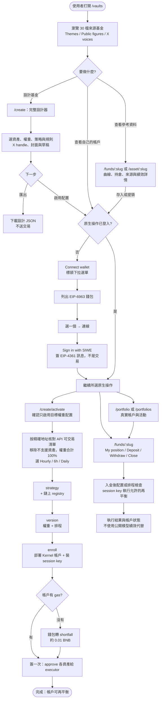
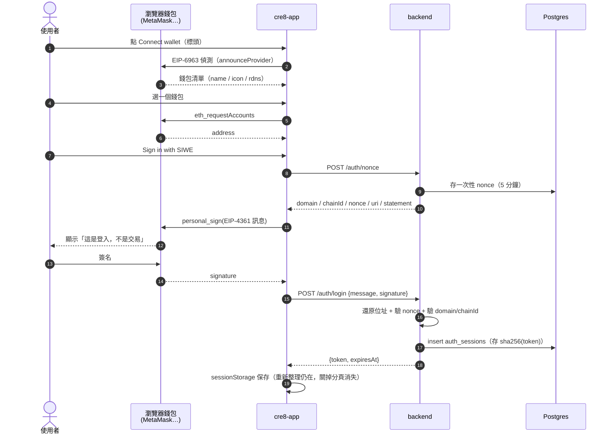
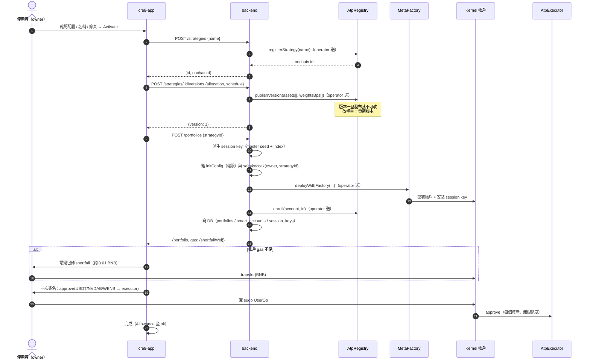
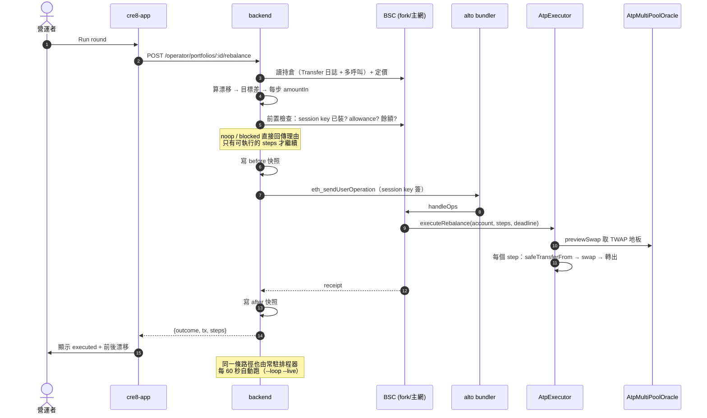
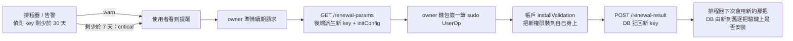

# User flows

> 這份文件畫的是**使用者實際會走的路徑**，以及每一步在後端／鏈上發生什麼事。
> 對照程式碼：`src/components/WalletMenu.tsx`（登入）、`src/features/reference/`（公開基金與資產）、
> `src/features/create/DesignFundPage.tsx`（設計）、`CreateFundPage.tsx`（原生啟用）、
> `src/features/fund/FundPage.tsx`（帳戶操作）、`src/features/operator/OperatorPage.tsx`（營運）。
> 2026-11-11 更新：完整公開資料與執行邊界見 [public-ui-integration.md](public-ui-integration.md)。

---

## 0. 一張圖看完

公開目錄、資產頁與設計器不要求 SIWE。公開 30 檔是有來源的參考模型，不會因為出現在目錄就自動建立 Registry 策略。
啟用只匯入精確代幣地址及目標權重；設計器其他規則和費率保留在匯出檔，不會默默啟動。
基金頁的 `?performance=1`／`?trades=1`／`?update=<id>`／`?tokens=1` 開啟對應資料，
`?position=1` 開啟真實帳戶抽屜，手機下單使用 `?ticket=1`，提領可用 `?tab=withdraw`。

---

## 1. 登入（沒有交易、沒有 gas）

**重點**：SIWE 只是證明「你擁有這個位址」。**鏈上權限與 session key 完全不受影響** ——
登入與否不改變任何合約狀態。

---

## 2. 啟用配置：3 個 API + 條件式錢包互動

此圖從 `/create/activate` 開始；`/create` 的設計、草稿及 JSON 匯出本身不呼叫以下 API。
從草稿匯入時須確認目標權重模式，資產仍依 API 的精確地址及可交易狀態檢查。

**為什麼 approve 是 owner 簽、而部署不是**：`AtpExecutor._swap` 用 ERC-20
`safeTransferFrom` 從**帳戶**拉幣，所以 allowance 必須由帳戶給。session key 給不了
（CallPolicy 只白名單 `executeRebalance`），而後端沒有 owner 私鑰。詳見 `architecture.md`。

---

## 3. 一輪再平衡（session key 簽名）

現行手動營運入口在 `/operator` 的 Run round；基金頁入金後則使用 owner 的再平衡端點執行首次配置。
下圖描述營運路徑，不代表公開基金頁有 Re-analyse 按鈕；兩條路徑均由後端規劃，不由公開參考曲線決定交易。

---

## 4. Session key 續期的 API 參考

續期 API 與 SDK 呼叫保留在 `src/lib/api.ts`／`src/lib/kernel.ts`。目前路由沒有
`/portfolios/:id` 或舊的 RenewalCard；此圖是 owner 續期的協定參考，不宣稱已提供該公開操作入口。

**舊 key 不會被撤銷** —— 它到自己的到期日為止仍然有效。這是刻意的：撤銷需要另一筆交易，
而多一把有效 key 的風險低於「續期失敗導致資金卡住」。

---

## 5. 失敗時使用者會看到什麼

| 情況 | 使用者看到的 | 系統實際狀態 |
|---|---|---|
| 錢包拒絕簽名 | 選單裡留著錯誤訊息，可重試 | 沒有任何鏈上動作 |
| 帳戶沒 gas | approve 失敗，訊息說明 gas | 帳戶存在但付不出 op |
| 沒 approve | 帳戶 Allowance 提示或再平衡 `blocked` | 不送不符合前置條件的交易 |
| 空倉 | Needs funding；再平衡結果為 `noop` | 沒有部位可搬 |
| API 不支援的設計資產 | `/create/activate` 列出 unavailable，要求移除並重新檢查權重 | 可在設計器研究，但不能直接啟用 |
| fork/RPC 掛掉 | 503 + 說明「讀不到狀態」 | **不顯示任何漂移數字**（刻意的） |
| 算不出執行後漂移 | `cannot be estimated yet` | 保留完整間隔，不亂調度 |
