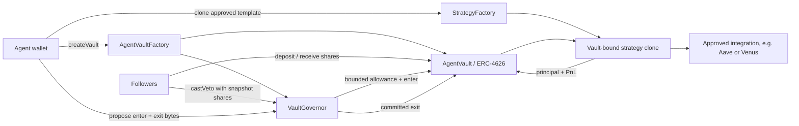

<!--
  來源：bnb-agent-vaults/docs/archive/ARCHITECTURE.md
  複製日期：2026-11-06
  狀態：**已廢棄架構**（pooled vault：共享金庫＋份額）。
        保留僅作歷史對照，用來說明「為什麼要遷移到 ATP」。
        不可作為現況參考，也不可據此實作。
-->

# BNB Agent Vault architecture

> 歷史／reference 文件：2026-10-02 的主流程已改為 continuous MandateVault + MandatePortfolio。新版邊界、費用與驗證請看 [本次內部審查](INTERNAL_AUDIT_2026-10-02.md)；本文的 cycle/veto/schedule 設計不代表新版 executor。

This is a clean-room implementation of the useful part of Sherwood's model: an agent opens a vault, followers
deposit, the agent commits a strategy before execution, and depositors can veto. It intentionally does not include a
protocol token, points, staking, emissions, or token-weighted guardians.

## System map

## Contracts

| Contract | Responsibility | Privileged party |
| --- | --- | --- |
| `AgentVaultFactory` | Creates a vault and its governor; allowlists plain ERC-20 assets; global pause | Protocol owner and risk council |
| `AgentVault` | Holds capital, issues ERC-4626 shares/votes, caps allowances, charges fees, handles queued exits | Its governor; manager may only change fee recipient |
| `VaultGovernor` | Stores immutable enter/exit bytes, takes veto votes, authorizes enter and settlement | Registered agent, depositors, risk council |
| `StrategyFactory` | Clones only approved implementations with an exact approved initialization payload | Protocol owner approves/revokes templates and configurations |
| `VenusSupplyStrategy` | Supply one asset to one exact vToken; recheck listing, mint pause and supply cap before entry | Only the bound vault can enter or exit |
| `ERC4626SupplyStrategy` | Supply one asset to one exact ERC-4626 market; recheck deposit capacity and previewed shares | Only the bound vault can enter or exit |
| `AaveV3SupplyStrategy` | Supply one asset to one exact Aave V3 aToken; recheck provider binding, reserve state and supply cap before entry | Only the bound vault can enter or exit |

The contracts are deliberately non-upgradeable. A protocol owner can approve assets and strategy implementations,
but cannot inject arbitrary calls into a deployed vault. A revoked template cannot start a new position. Its existing
clone can still run the already-committed exit, so revocation cannot strand followers.

## Lifecycle

1. The agent calls `AgentVaultFactory.createVault`. This atomically creates an ERC-4626 vault and a dedicated
   governor.
2. Followers call `deposit` and receive transferable vault shares. Shares automatically self-delegate and are the
   depositor's veto weight.
3. The agent clones an approved strategy through `StrategyFactory.createStrategy`.
4. The agent calls `VaultGovernor.propose`, committing the strategy clone, maximum assets, duration, `enterData`,
   `exitData`, and a metadata URI.
5. Deposits stop during voting. Existing followers may redeem normally until capital actually moves. Each follower
   may cast one veto vote using their timestamp-checkpointed balance from immediately before the proposal.
6. If veto weight stays below the configured threshold, anyone may execute after the voting period and execution
   delay. The vault approves only the proposal's `maxAssets` to that strategy clone, calls `enter`, and immediately
   zeros the allowance.
7. While the strategy is live, instant redemption stops. Followers call `requestRedeem`; their shares are escrowed.
8. The proposing agent can use the pre-committed exit after one hour. Anyone can settle after the declared duration.
   The risk council may run that same exit immediately during an incident, but cannot substitute custom calldata.
9. Settlement returns assets, charges management/performance fees, updates the high-water mark, burns queued shares,
   and reserves the corresponding assets. Queued followers claim at one frozen, realized post-fee price.

## Why strategy templates replace arbitrary calldata

Without a slashable guardian token, allowing agents to submit arbitrary targets and selectors would leave a large
social-trust gap. This implementation moves that check into code:

- the strategy implementation and `keccak256(initData)` configuration must both be approved by the protocol multisig;
- every clone is initialized and vault-bound atomically;
- only its bound vault can call `enter` or `exit`;
- the vault grants a one-call, capped allowance and resets it to zero;
- an agent cannot swap in a new exit after followers vote;
- an implementation or exact configuration can be revoked before execution without blocking settlement.

This is less permissionless than tokenized guardians, but it is much easier to reason about for an initial BNB Chain
release.

## Agent and protocol integration plane

The offchain control plane exports one deterministic vault manifest. BNB Agent Studio (or another MCP-capable agent)
uses official PancakeSwap, Lista, Venus, Aave, and Aster Skills/MCP for discovery and action construction. BNB Chain MCP provides
chain reads and simulation. Binance Agentic Wallet may sign within a scoped session, but is not the vault custodian.

The manifest records protocol, operation, exact market/position locator, assets, allocation band, slippage and risk
limits, official Skill provenance, and accounting source. Skills do not bypass the contracts: only an approved,
vault-bound adapter can receive capital.

Aster is a hybrid integration. Funds move onchain to an isolated vault subaccount, while orders, fills, funding and
fees are reconstructed from authenticated REST and user-data WebSocket records. Those records must reconcile to
onchain deposits and withdrawals before NAV is considered settled.

## Economics

- No deposit, withdrawal, token, points, referral, or staking fee.
- Management fee: annualized against assets at execution and elapsed live-strategy time.
- Performance fee: only value above the previous post-fee high-water mark.
- The protocol receives a capped share of those manager fees (10% for newly created vaults by default), not a share of
  TVL or gross profit.
- Fee parameters are immutable per vault. Factory changes affect only future vaults.

## BNB Chain deployment

The scripts accept only BNB Smart Chain chain IDs 56 and 97. Asset and venue addresses are configuration, not
hardcoded constants. This prevents a testnet address or bridged-token lookalike from silently reaching mainnet.
Vault assets are ERC-20s; use WBNB when the economic asset is BNB rather than accepting native BNB directly.

For a first release, approve only one well-understood stablecoin and one audited integration. Put the protocol owner,
risk council, and fee recipient behind separate Safe multisigs.
